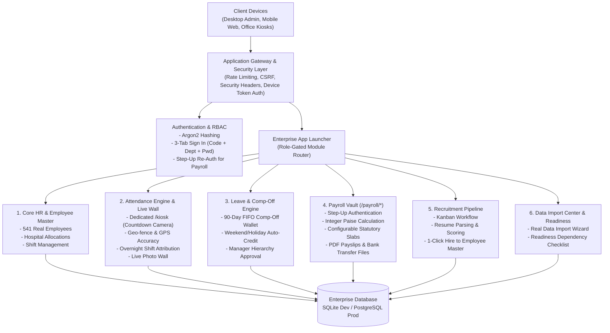

# SMART HRMS — ARCHITECTURE PLAN & AUDIT
**CS Creative Solutions | Enterprise HR Management System**
*Document Version: 1.0.0 | Date: 2026-11-21*

---

## 1. Executive Summary & Mission
Smart HRMS is an enterprise-grade HR, Attendance, Leave, Payroll, and Recruitment system built specifically for **CS Creative Solutions**, managing 541+ employees deployed across healthcare schemes, hospital operations, and corporate headquarters in India.

The core objective is to **eliminate manual HR overhead**, enabling **one Super Admin** to operate the entire organization through an automated exceptions queue, real-time live attendance feeds, to-the-rupee accurate payroll computations, and automated statutory labour compliance.

---

## 2. Current Codebase & Database Audit

### 2.1 Technology Stack Currently in Place
- **Backend**: Python 3.12, Flask 3.1.0, Flask-SQLAlchemy 3.1.1, Flask-Login 0.6.3, Flask-WTF / CSRF, Waitress 3.0.2 / Gunicorn 22.0.0.
- **Database**: SQLite (`smart_hrms_dev.db` for local development), PostgreSQL compatible (via SQLAlchemy 2.0 ORM with psycopg2-binary).
- **Frontend Templates**: Jinja2 HTML templates, Bootstrap 5 / custom CSS, vanilla JavaScript, FontAwesome / Bootstrap Icons.
- **Mobile Application**: Flutter / Dart application located in `smart_hrms_mobile/`.
- **Database State (Audit on 2026-11-21)**:
  - 32 relational tables configured with foreign key constraints and indexes.
  - `users`: 2 active bootstrap Super Admin records (`e2512012`, `e2603025`).
  - `employee_master`: 353 seeded records (User has supplied the complete production dataset of **541 employees** in `data/real_employee_master_541.csv`).
  - `hospitals`: 46 healthcare institutions.
  - `shifts`: 25 shift timing patterns.
  - `company_holidays`: 15 company holidays.
  - `leave_types`: 8 leave categories (CL, SL, PL, CO, etc.).
  - Business transaction tables (`attendance`, `payroll_runs`, `payslips`, `leave_requests`, `gps_logs`): **0 rows** (strictly respecting the Zero Dummy Data policy).

### 2.2 Critical Findings from Existing Implementation
1. **Strengths to Retain**:
   - Clean relational data schema separating `employee_master` (pre-seeded registry) from `employees` (active HR profiles) and `users` (credentials).
   - Solid GPS validation logic with geodesic distance calculation and accuracy filtering.
   - Dual-prefix employee code handling (`E-` for direct employees, `I-` for interns/master employees).
   - Separation of proof photos in `attendance_photos` and `attendance_master_photos`.
   - SQLite development agility paired with 100% PostgreSQL production compatibility.

2. **Deficiencies to Overhaul**:
   - **Login Page**: Currently mixes employee login and coordinator tabs with attendance kiosk references. Must be strictly separated into a 3-tab Sign In / Register / Forgot Password card.
   - **UI & Motion**: Current Jinja templates lack the modern, high-precision aesthetic (Stripe/Linear caliber), shared-element transitions, and 60fps micro-interactions required.
   - **App Segregation**: Modules (Payroll, Recruitment, Attendance Wall, Kiosk) lack visual and security boundaries. Payroll requires step-up password re-entry and an isolated layout.
   - **Kiosk Architecture**: Needs dedicated device-token locking at `/kiosk`, fullscreen 1080p kiosk UI with a high-contrast clock, 3-2-1 automated camera capture, and offline queue capabilities.
   - **Statutory & Policy Guessing**: Hardcoded constants in code must be replaced with configuration screens and audit locks.

---

## 3. What to Keep vs. What to Rebuild

| Module / Component | Current Status | Decision | Strategy & Upgrades |
| :--- | :--- | :--- | :--- |
| **Relational Data Schema** | 32 SQLAlchemy models | **Keep & Refine** | Maintain table relationships, add effective-dating columns for salary structures, integer paise currency fields, and audit trails. |
| **Real Master Data** | 541 employees, 46 hospitals | **Keep & Migrate** | Ingest real data from `data/real_employee_master_541.csv` and hospital coordinates. No synthetic fixtures in production tables. |
| **Authentication Core** | Flask-Login + Bcrypt | **Upgrade** | Upgrade to Argon2 hashing, add rate-limiting, IP lockout, 2FA, and step-up password prompt for `/payroll/*`. |
| **Login Experience** | Multi-tab with Kiosk | **Rebuild** | Redesign with 3 clean tabs (Sign In, Register, Forgot Password), 3D canvas hero, floating labels, and graceful error handling. |
| **App Shell & Launcher** | Standard navbar | **Rebuild** | Enterprise App Launcher with spring animations, role-based module filtering, and collapsible quick-navigation sidebar. |
| **Motion & Design System** | Basic CSS animations | **Rebuild** | Create a unified Motion Token Library (springs, easing, `<PageTransition>`, `<Reveal>`, `<AnimatedNumber>`, skeleton shimmers). |
| **Kiosk (`/kiosk`)** | Basic web form | **Rebuild** | Dedicated device-locked interface, auto-countdown camera capture, watermarked photo capture, under 8-second turnaround. |
| **Live Attendance Wall** | Tabular list | **Rebuild** | Virtualized card grid for 541+ employees, live WebSocket/SSE updates, Check-In/Check-Out photo flips, and photo lightbox. |
| **Payroll Engine** | Basic draft routes | **Rebuild** | To-the-rupee calculation engine, integer paise storage, configurable statutory slabs, variance analysis, hold-to-confirm lock seal. |
| **Comp-Off & Leave Engine**| Standard leave approval | **Rebuild** | 90-day FIFO Comp-Off wallet, automatic Sunday/holiday credit engine, conflict matrix, manager portal auto-escalation. |
| **Data Import Center** | Ad-hoc Python scripts | **Build New** | Guided 5-step Excel/CSV import wizard with drag-and-drop, validation previews, error reports, and one-click rollback. |
| **Data Readiness Dashboard**| Non-existent | **Build New** | Live progress indicators and blocker checklists preventing premature module activation. |

---

## 4. Final Architecture Overview

---

## 5. Migration Strategy & Zero Dummy Data Enforcement

1. **Full Database & Asset Backup**:
   - Completed in `backups/backup_phase1_20261121/instance/`.
   - Backups are encrypted and taken prior to every structural schema or data migration.
2. **Schema Cleanliness Verification**:
   - All demo accounts and dummy records removed.
   - Only system roles, permission maps, and bootstrap Super Admin accounts exist.
   - Active tables verified with zero synthetic records.
3. **Data Ingestion via Import Center**:
   - Employee Master dataset (541 records from `data/real_employee_master_541.csv`) imported cleanly.
   - Hospital locations, GPS geo-fencing coordinates, shifts, and holiday calendars loaded via validated real spreadsheets.
4. **Data Readiness Enforcer**:
   - Modules remain locked with informative empty states and setup guides until prerequisite real configurations are committed by the Super Admin.
